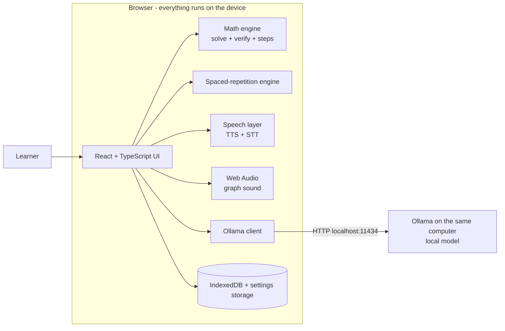
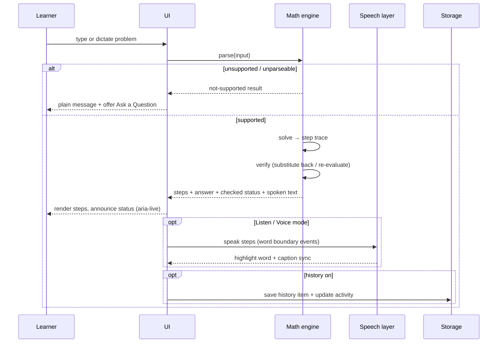
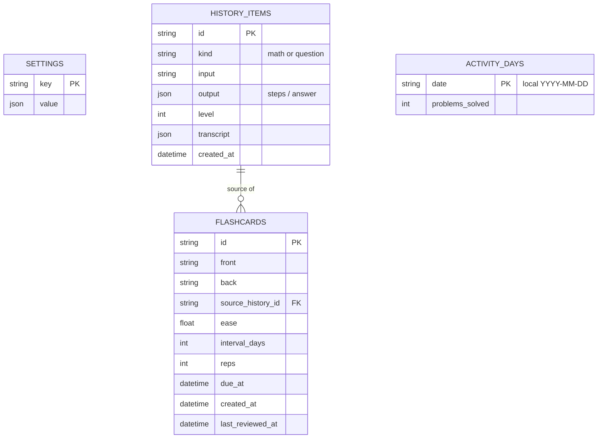

# SAD — System / Software Architecture Document

> Accessible Academic Problem Solver · Team Neurobridge · **v0.2** · 2026-10-11
> Explains **how the system is structured**. Concrete tools, libraries and commands are in `04_TAD.md`.
> **Change in v0.2:** the architecture now matches the frontend prototype — a **local-first browser app** (nothing uploaded, AI through the learner's own **Ollama**). The FastAPI + PostgreSQL backend from the pitch deck moves to **Phase 2**.

## 1. Architecture goals

| Goal | Consequence |
|---|---|
| Private by default | All processing and storage on the learner's device; no accounts, no telemetry, no third-party scripts |
| Exact math | A deterministic on-device math engine computes and verifies; the LLM never does the arithmetic |
| Inclusive delivery | Every result can be shown as text, speech with word highlighting, and captions/transcript |
| Fast to build (hackathon) | Single-page app, no server to deploy for the MVP |
| Provider-independent AI | All model calls go through one Ollama client module |
| Honest scope | Deferred features (blind support, image/PDF) have no half-built code paths in the UI |

## 2. System context (Phase 1 — MVP)



- **No application server** in Phase 1. The built app is static files.
- **Ollama** runs separately on the learner's computer; the browser talks to it over HTTP on `localhost`.
- **Speech** uses the browser's built-in speech APIs (see §8 for the privacy caveat).

## 3. Logical architecture

```
┌──────────────────────────────── Presentation (React) ────────────────────────────────┐
│ AppShell (header, nav) · Pages: Home, Solve Math, Ask, Graph & Sound, Flashcards,    │
│ Voice Learning, History, Settings                                                    │
├──────────────────────────────── Accessibility layer ─────────────────────────────────┤
│ Mode context · learner profiles · Announcer (aria-live) · visual alerts · focus      │
│ management · captions/transcript components                                          │
├──────────────────────────────── Domain services (pure TS) ───────────────────────────┤
│ math/ (parse · solve · steps · verify · speak)   srs/ (scheduler)                    │
│ ollama/ (status · models · chat stream · prompts · schemas)                          │
│ speech/ (TTS with word boundaries · STT · voice commands)                            │
├──────────────────────────────── Data layer ──────────────────────────────────────────┤
│ storage/ (IndexedDB stores: settings, history, flashcards, activity) · export/import │
└──────────────────────────────────────────────────────────────────────────────────────┘
```

**Layering rules**
1. Pages/components never call `fetch` or IndexedDB directly — only services/stores.
2. Only `ollama/` talks to the model server.
3. Only `math/` computes mathematical results.
4. Only `storage/` reads/writes persistent data.
5. Accessibility behaviour (announcing, focus, modes) comes from the shared accessibility layer, not re-implemented per feature.

## 4. Components

| Component | Responsibility | Feature |
|---|---|---|
| **AppShell** | Header (title, language, privacy badge, Voice command), side navigation, skip link, landmarks | all |
| **Learner profiles** | Presets for Deaf / HoH and Standard that set modes; deferred profiles are not registered | Home |
| **Accessibility context** | Holds modes, writes `data-*` attributes on `<html>`, exposes `useAnnounce`, visual alerts | Settings |
| **Math engine** | Parse input → solve → produce step trace → verify → LaTeX + spoken text | Solve Math |
| **Ollama client** | Detect server, list models, stream chat, structured output, cancel | Ask a Question |
| **Prompt set** | Level 1/2/3 prompts, clarification rules, "ask about this" prompt | Ask, Levels |
| **Speech layer** | TTS with word/sentence boundary events, caption sync, STT, voice-command parser | Voice Learning, Voice command |
| **Caption & transcript** | Sentence/word-indexed text; search, edit (P1) | Captions |
| **SRS engine** | SM-2-style scheduling, due queue | Flashcards |
| **Progress service** | Streak, problems solved, weekly activity, counters | Home |
| **Graph & sound** | Function plotting + Web Audio tone mapping, text summary, data table | Graph and Sound (P1) |
| **Storage** | IndexedDB wrapper, settings, history toggle, export/import, delete-all | History, Settings |

## 5. Key runtime flows

### 5.1 Solve a mathematics problem


### 5.2 Ask a question (local Ollama)
```mermaid
sequenceDiagram
  participant U as Learner
  participant UI as UI
  participant O as Ollama client
  participant L as Ollama (localhost)
  U->>UI: question + level
  UI->>O: ask(question, level, context)
  O->>L: GET /api/tags (if status unknown)
  O->>L: POST /api/chat (stream)
  L-->>O: streamed chunks
  O-->>UI: chunks → rendered paragraphs
  UI-->>U: announce per paragraph; show limits note + actions
  Note over UI,L: If unreachable: status panel with setup help
```

### 5.3 Flashcard review
Due query (`due_at ≤ now`) → show front → reveal → rating → SRS scheduler computes the next `due_at` → store → update Home counters.

### 5.4 Voice and captions
TTS speaks a sentence list; boundary events highlight the current word (fallback: sentence). The caption bar and transcript use the same indexed text, so search, edit and sentence replay share one data structure. Voice commands: mic → recognised text shown → parsed into an intent → confirmed or executed.

## 6. Data architecture (on-device)



| Store | Purpose |
|---|---|
| `settings` | Profile, modes, level, Ollama URL + model, voice, speed, language, `save_history` flag |
| `history_items` | Solved problems and Q&A (only when history is on) |
| `flashcards` | Cards and scheduling fields |
| `activity_days` | Daily counts for streak and the "This week" strip |

**Derived values**
- *Day streak:* consecutive local dates with ≥ 1 solved problem, ending today — or yesterday if nothing is solved yet today (proposal).
- *Flashcards due / saved:* count of `due_at ≤ now` / total cards.

**Persistence rules:** all writes go through `storage/`; every storage call is wrapped in try/catch with a safe fallback; export/import is a single JSON file; "Delete all my data" clears every store and settings key.

## 7. Deployment architecture

| Part | Phase 1 setup |
|---|---|
| Web app | Static build; run locally (`npm run dev` / preview) or host on a static host such as Vercel |
| AI | Ollama installed on the learner's computer with a model pulled in advance |
| Data | Browser IndexedDB on the learner's device |

**Browser ↔ Ollama access** (important for the demo)
- Ollama listens on `localhost` (default port 11434). When the app is served from a **different origin** than localhost, Ollama must be configured to allow that origin (`OLLAMA_ORIGINS`).
- A page served over **HTTPS** calling `http://localhost` may be restricted or prompt for permission depending on the browser version. Test on the exact demo browser; the safest demo setup is to **run the app locally**.

### Phase 2 (deferred) — optional backend and desktop
Adds FastAPI + PostgreSQL (+ S3) for accounts, sync, teacher materials and heavy processing, and a desktop app with local OCR / vision for image and PDF input. The Phase 1 storage and Ollama modules stay behind interfaces so a sync/backend layer can be added without rewriting the UI.

## 8. Security and privacy architecture

| Concern | Design |
|---|---|
| "Nothing is uploaded" | No analytics, no external fonts/scripts/CDNs; assets self-hosted; Content-Security-Policy `connect-src` limited to the app origin and the configured Ollama address |
| Speech privacy | **Caveat:** in some browsers, speech recognition (and some TTS voices) use the browser vendor's cloud service. Either word the privacy badge precisely, or use on-device recognition where available. Decision pending (PRD R7) |
| Prompt content | Sent only to the local Ollama address; never logged to a remote service |
| Data at rest | Stored unencrypted in the browser profile of the learner; shared computers → "Delete all my data" and history-off are first-class settings |
| Input safety | Rendered AI/Markdown output is sanitised (no raw HTML injection); math input is parsed, never `eval`-ed |
| Uploaded files | Not applicable in Phase 1 (no image/PDF input) |
| Prompt injection | Pasted text is treated as data in prompts; output validated against a schema where structured |

## 9. Cross-cutting design

- **Error model:** typed result objects (`ok` / `error` with plain-language `message` and `hint`) — messages are read by assistive technology, so no raw stack traces or codes alone.
- **Accessibility as architecture:** modes → `data-*` attributes → CSS tokens; announcer and visual alerts are shared modules.
- **Graceful degradation:** no Ollama → math, flashcards, voice and history still work; no speech APIs → text only; storage blocked → session-only mode with a warning.
- **Caching:** AI answers cached locally by `hash(question + level + model + prompt_version)` to save time on repeats.
- **Observability:** developer-only console logging behind a debug flag; nothing is sent anywhere.

## 10. Architecture decisions (ADRs)

| # | Decision | Reason | Trade-off |
|---|---|---|---|
| 1 | Local-first, no backend in Phase 1 | Matches the prototype ("runs on this device"); strongest privacy; no hosting cost | No accounts/sync/teacher features until Phase 2 |
| 2 | Local LLM through Ollama | Free, private, works offline | Needs installation and capable hardware; smaller models are less accurate |
| 3 | Deterministic math engine for exact results | LLMs make arithmetic errors; "checked" must mean verified | Limited problem types; each type needs engine support |
| 4 | Browser speech APIs for TTS/STT | Zero cost, no server | Quality and word-boundary support vary; possible vendor-cloud use (privacy caveat) |
| 5 | IndexedDB for all persistent data | Larger and more structured than localStorage; works offline | Browser-profile bound; export/import needed |
| 6 | Single UI with combinable modes and profile presets | Matches "no separate websites" | Careful CSS/ARIA work |
| 7 | Defer blind / low-vision support and image/PDF features | Cannot be delivered reliably now; avoids misleading claims | Narrower initial audience; must be revisited (Phase 3) |
| 8 | FastAPI + PostgreSQL moved to Phase 2 | Not needed for local-first MVP | Pitch deck must be updated to match |

## 11. Future evolution
Backend with accounts and sync; teacher dashboard; desktop app with local OCR/vision for images and PDFs; on-device speech recognition; multilingual models and voices; blind / low-vision and deafblind support (descriptions, Braille, screen-reader-grade UX) after testing with those learners.
